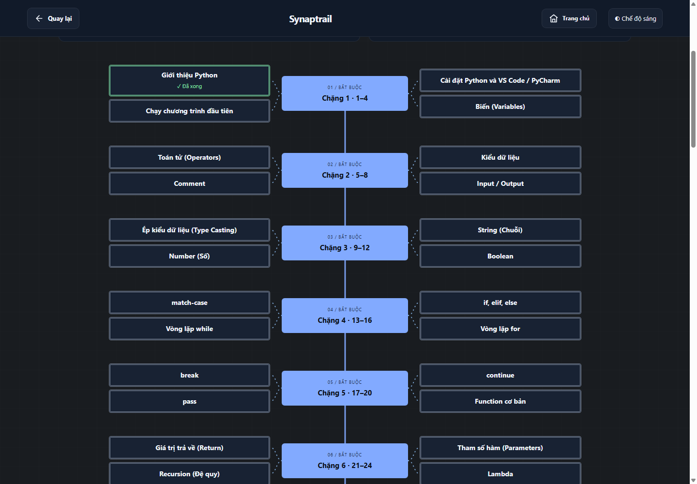
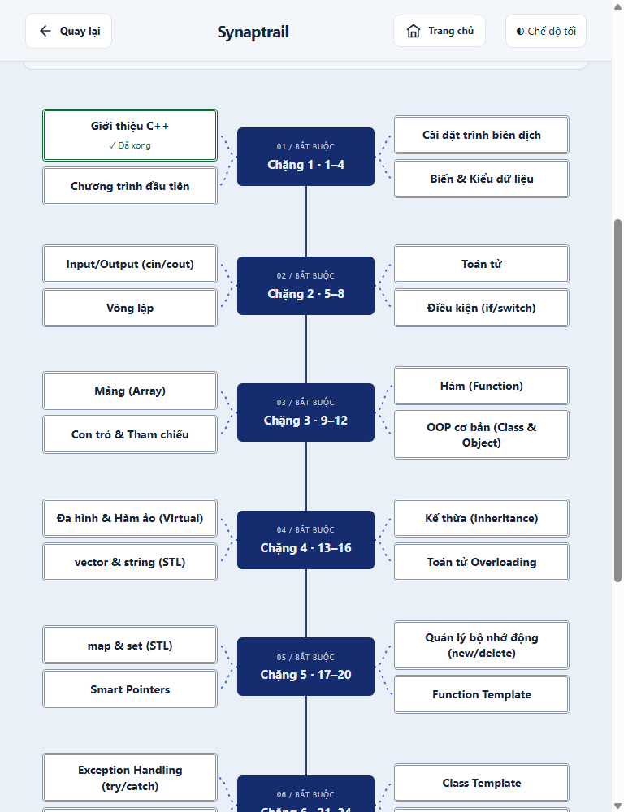
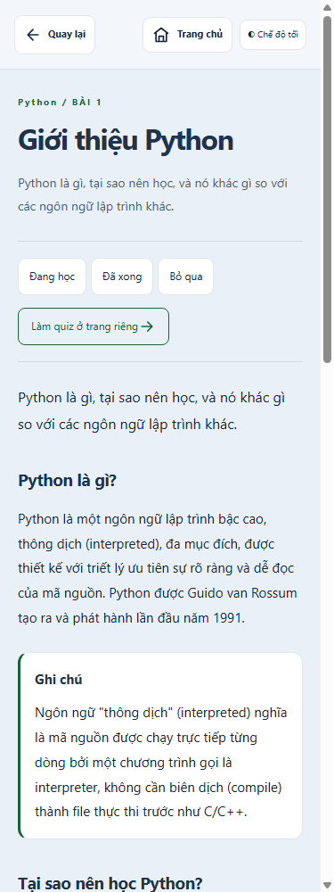
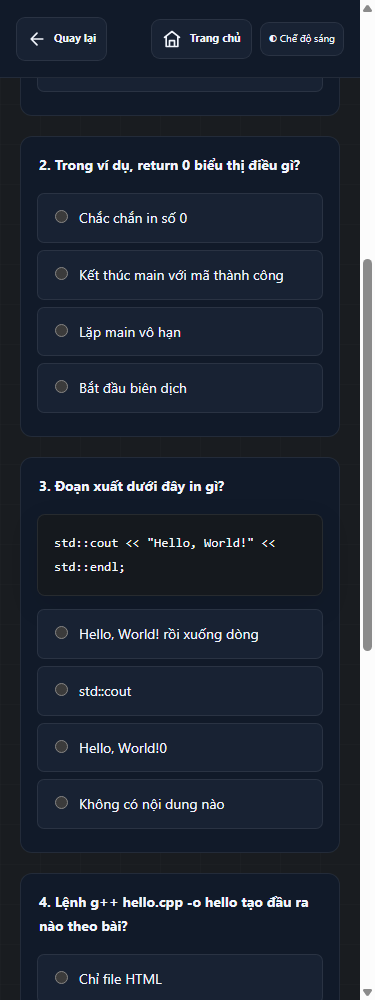

# Đồng bộ các khóa học theo mẫu Thuật toán

Đã áp dụng cho 22 khóa còn lại: 338 trang nội dung, 22 đường dẫn Fullstack cũ được giữ, 132 chương có quiz với 237 câu hỏi có sẵn. Không thêm câu hỏi hay chương học mới. Trang chủ, catalog và các công cụ ôn tập giữ chức năng hiện tại.

Mỗi mục lục hiển thị sơ đồ trục giữa và nhánh hai bên; dưới 768px chuyển sang danh sách đúng thứ tự học. Card bài mở trang bài riêng, card nhóm mở trang chủ đề. Quiz nằm ở trang riêng. Nút Trang chủ và Quay lại dùng chữ đậm, icon SVG; dữ liệu tiến độ dùng chung kho lưu trữ nhưng tách khóa. Các card Fullstack đọc tiến độ từ bài thật ở khóa đích.

Nguồn được đọc từ các trang gốc trước chuyển đổi (Git revision f10b361); chỉ thay khung trình bày, tách quiz và chuyển sự kiện Copy/mở bài tập vào JS dùng chung. Nguồn sau chuyển đổi ở assets/roadmaps/<khóa>-source.json. Lộ trình chỉ tải dữ liệu nút nhỏ; câu hỏi chỉ tải tại trang quiz. Các khóa chưa có phân nhóm chủ đề sẵn được chia thành chặng bốn bài theo thứ tự hiện có; có thể điều chỉnh nodes/layout mà không sửa logic vẽ.

## Phạm vi theo khóa

| Khóa | Trang nội dung | URL chuyển tiếp giữ nguyên | Chương có quiz | Câu hỏi |
| --- | ---: | ---: | ---: | ---: |
| [AI Engineer](../../ai-engineer/index.html) | 22 | 0 | 10 | 10 |
| [Bootstrap](../../bootstrap/index.html) | 2 | 0 | 1 | 1 |
| [C++](../../cpp/index.html) | 32 | 0 | 14 | 34 |
| [Docker](../../docker/index.html) | 3 | 0 | 1 | 1 |
| [Fullstack JavaScript](../../fullstack-js/index.html) | 0 | 22 | 0 | 0 |
| [Git](../../git/index.html) | 2 | 0 | 1 | 1 |
| [GraphQL](../../graphql/index.html) | 2 | 0 | 0 | 0 |
| [HTML & CSS](../../html-css-nnlt/index.html) | 18 | 0 | 6 | 6 |
| [Java](../../java/index.html) | 31 | 0 | 15 | 39 |
| [JavaScript](../../javascript-nnlt/index.html) | 34 | 0 | 11 | 11 |
| [Ngôn ngữ lập trình](../../languages/index.html) | 10 | 0 | 0 | 0 |
| [Machine Learning](../../machine-learning/index.html) | 16 | 0 | 0 | 0 |
| [MySQL](../../mysql/index.html) | 3 | 0 | 1 | 1 |
| [NestJS](../../nestjs/index.html) | 2 | 0 | 1 | 1 |
| [ORM](../../orm/index.html) | 2 | 0 | 1 | 1 |
| [Python](../../python/index.html) | 108 | 0 | 31 | 36 |
| [React](../../react/index.html) | 26 | 0 | 26 | 82 |
| [Sass](../../sass/index.html) | 2 | 0 | 1 | 1 |
| [Bảo mật](../../security/index.html) | 10 | 0 | 5 | 5 |
| [Socket.IO](../../socketio/index.html) | 1 | 0 | 1 | 1 |
| [System Design](../../system-design/index.html) | 10 | 0 | 5 | 5 |
| [TypeScript](../../typescript/index.html) | 2 | 0 | 1 | 1 |

## Kiểm tra

- check-course-roadmaps: 132 tổ hợp theme/kích thước; kiểm tra thêm toàn bộ 338 trang ở 375px. Không tràn ngang, chồng card, mất nội dung nguồn, sidebar cũ, quiz nhúng, lỗi JavaScript hoặc tài nguyên ngoài.
- check-course-roadmaps --layout-only: 132 trường hợp sau sửa giao diện; Fullstack được kiểm tra riêng thêm sáu trường hợp sau đổi tiêu đề card. Thứ tự hiển thị mobile khớp dữ liệu.
- check-course-interactions: Copy dùng logic chung; đã kiểm tra mở/đóng bài tập, xem/ẩn đáp án, giữ đoạn code quiz, tiến độ riêng từng khóa, tiến độ Fullstack dùng bài đích, reduced motion và nội dung không JavaScript.
- check-first-five-quizzes: 15 chương / 75 câu / 300 lựa chọn đạt; mã trong câu hỏi đọc code được giữ nguyên.
- check-progress: lưu/đọc, giữ điểm cao nhất, gộp nhập, JSON không hợp lệ, reset, bộ nhớ bị chặn/hết dung lượng đều đạt.
- check-algorithm-roadmap: kiểm tra hồi quy 23 bài Thuật toán, quiz riêng, theme, reduced motion, file:// và điều hướng đạt.
- check-ui: 493 trang, còn 10 lỗi cũ ngoài các trang khóa học đã chuyển: thiếu meta description ở courses.html và bảy trang Quiz_and_other; projects/fullstack-js.html thiếu h1 và meta description. Chi tiết trong [check-ui.json](check-ui.json). Không sửa các lỗi SEO này trong đợt giao diện.
- Chạy lại migrate-course-roadmaps --dry-run sau hoàn tất: không có thay đổi cần ghi.

## Ảnh và việc đã sửa sau khi xem ảnh

Đã chụp 366 ảnh lộ trình/bài học/quiz theo khóa × sáu kích thước/theme, thêm ảnh quiz có code. Đã xem 18 bảng ảnh tổng hợp dưới đây và ảnh chi tiết đại diện; các kiểm tra tự động bổ sung đo tràn trang, chồng và cắt chữ. Danh sách ảnh gốc trong [browser-checks.json](browser-checks.json), thư mục [screenshots](screenshots/).

- Sửa thứ tự mobile từ gom nhánh trái/phải thành đúng thứ tự bài.
- Sửa chữ SVG trong bài Machine Learning để đọc được ở theme tối; sơ đồ rộng cuộn bên trong khung, không làm tràn trang.
- Giữ đoạn code của câu quiz đọc mã sau khi tách trang.
- Sửa card Fullstack trùng tên bằng tiêu đề thật và dùng chung tiến độ với bài đích.
- Nút điều hướng ở các trang sinh mới có SVG ngay cả khi tắt JS.

### Lộ trình

| Theme | 375px | 768px | 1440px |
| --- | --- | --- | --- |
| dark | [Ảnh](map-dark-375-overview.png) | [Ảnh](map-dark-768-overview.png) | [Ảnh](map-dark-1440-overview.png) |
| light | [Ảnh](map-light-375-overview.png) | [Ảnh](map-light-768-overview.png) | [Ảnh](map-light-1440-overview.png) |

### Bài học

| Theme | 375px | 768px | 1440px |
| --- | --- | --- | --- |
| dark | [Ảnh](lesson-dark-375-overview.png) | [Ảnh](lesson-dark-768-overview.png) | [Ảnh](lesson-dark-1440-overview.png) |
| light | [Ảnh](lesson-light-375-overview.png) | [Ảnh](lesson-light-768-overview.png) | [Ảnh](lesson-light-1440-overview.png) |

### Quiz riêng

| Theme | 375px | 768px | 1440px |
| --- | --- | --- | --- |
| dark | [Ảnh](quiz-dark-375-overview.png) | [Ảnh](quiz-dark-768-overview.png) | [Ảnh](quiz-dark-1440-overview.png) |
| light | [Ảnh](quiz-light-375-overview.png) | [Ảnh](quiz-light-768-overview.png) | [Ảnh](quiz-light-1440-overview.png) |

### Ảnh chi tiết tham khảo

## File và cách bảo trì

Danh sách chính xác các file tạo/sửa: [changed-files.md](changed-files.md). Danh sách các trang/dữ liệu do công cụ sinh: [migration.json](migration.json). Các URL chương cũ không đổi; 22 file chuyển tiếp Fullstack không bị ghi đè.

Chỉnh nguồn nội dung trong assets/roadmaps/<khóa>-source.json rồi chạy node scripts/migrate-course-roadmaps.cjs --dry-run để xem danh sách thay đổi; --apply chỉ ghi các trang từ dữ liệu nguồn. Thuật toán vẫn dùng công cụ sync-algorithm-roadmap riêng. Không cần CDN hay bước build khi mở website.

Giới hạn: kiểm tra bằng Chrome headless trên Windows, chưa thử trên điện thoại thật hoặc trình đọc màn hình. Chưa chạy lại từng ví dụ code trong giáo trình; nội dung kiến thức không được viết lại. Các tiện ích flashcard/bài tập/tra cứu vẫn giữ giao diện chuyên dụng. Nên mở một khóa từ catalog, thử vài card và chuyển theme để duyệt trải nghiệm thực tế.
